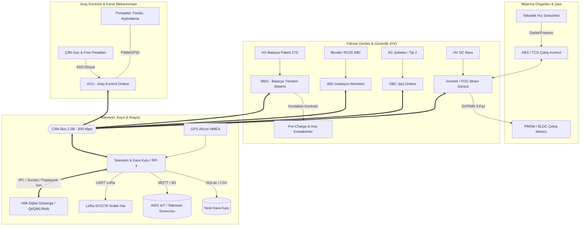

# ELEKTRİKLİ ARAÇ (EV) YAZILIM EKOSİSTEMİ: KAPSAMLI MİMARİ VE KODLAMA UYGULAMA PLANI

Bu doküman, `elektrikli_ara_kapsaml_kodlama_ve_yaz_l_m_mimari_plan.md` referans alınarak hazırlanan; **6 ana modülden** oluşan elektrikli araç yazılım ekosisteminin baştan sona (A'dan Z'ye) mimari tasarımı, veri modelleri, CAN haberleşme matrisi, güvenlik algoritmaları, yazılım bileşenleri ve faz faz kodlama yol haritasıdır.

---

## 1. MİMARİ GENEL BAKIŞ VE SİSTEM TOPOLOJİSİ

Sistem, otomotiv standartlarına (ISO 26262 fonksiyonel güvenlik ilkeleri, MISRA-C uyumluluğu, CAN 2.0B 500 kbps protokolü) uygun olarak tasarlanmıştır.



---

## 2. CAN-BUS İLETİŞİM AĞ MATRİSİ (CAN MATRIX / DBC)

Baudrate: **500 kbps**, Standart/Genişletilmiş ID: Standart 11-bit ID.

| CAN ID (Hex) | Mesaj Adı | Kaynak | Hedef | Periyot | İçerik (Sinyaller) |
| :--- | :--- | :--- | :--- | :--- | :--- |
| `0x100` | `VCU_Heartbeat_State` | VCU | Broadcast | 10 ms | Sistem Durumu (INIT, STANDBY, PRECHARGE, DRIVE, FAULT), Hata Kodu, Sürüş Modu (Eco/Sport) |
| `0x101` | `VCU_Torque_Command` | VCU | İnvertör | 10 ms | Hedef Tork (Nm, 0.1 çarpanı), Motor Enable (0/1), Yön (Fwd/Rev), Regen İzin (0/1) |
| `0x102` | `VCU_Aux_Status` | VCU | Telemetri/HMI | 100 ms | Pompa PWM %, Fan Kademesi, Işık Durumları, Fren Basılı Bayrağı |
| `0x200` | `BMS_Pack_Status` | BMS | VCU/HMI | 20 ms | Toplam Batarya Voltajı (0.1V), Akım (-500.0A - +500.0A, 0.1A), SOC (%0.1), SOH (%0.1) |
| `0x201` | `BMS_Limits_Alarms` | BMS | VCU | 50 ms | İzin Verilen Max Deşarj Akımı (A), İzin Verilen Max Şarj Akımı (A), Hata Bayrakları (OV, UV, OT, UT) |
| `0x202` | `BMS_Cell_Extremes` | BMS | Telemetri | 100 ms | Min Hücre Gerilimi (mV), Max Hücre Gerilimi (mV), En Sıcak NTC (°C), En Soğuk NTC (°C) |
| `0x300` | `INV_Motor_Feedback` | İnvertör | VCU/HMI | 10 ms | Gerçek Motor Hızı (RPM), Gerçek Tork (Nm), DC Bara Voltajı (V), DC Bara Akımı (A) |
| `0x301` | `INV_Thermal_Status` | İnvertör | VCU/Telemetri | 100 ms | İnvertör IGBT Sıcaklığı (°C), Motor Sargı Sıcaklığı (°C), Hata Durumu |
| `0x302` | `ABS_TCS_Status` | ABS/İnv | VCU/HMI | 20 ms | Tekerlek Kayma Oranı (Slip %), ABS Aktif (0/1), TCS Aktif (0/1), Tork Kısıt Oranı |
| `0x400` | `OBC_Status_Control` | OBC | VCU/BMS | 50 ms | AC Bağlantı Var (0/1), Pilot Sinyali Akım Limiti (A), Çıkış Voltajı (V), Çıkış Akımı (A), Şarj Durumu |
| `0x450` | `IMD_Status` | IMD | VCU/HMI | 100 ms | İzolasyon Direnci (kOhm), Durum (Normal, Uyarı, Hata, Donanım Hatası) |

---

## 3. MODÜLLERİN DETAYLI TEKNİK TASARIMI

### MODÜL 1: ARAÇ KONTROL ÜNİTESİ (VCU / AKS)
*   **Hedef Platform:** STM32F407 / STM32G474 (C99, FreeRTOS tabanlı mimari, PC SIL derlenebilir HAL katmanı)
*   **Dosyalar:**
    *   `vcu_state_machine.c` / `.h`: 5 ana durumlu deterministik durum makinesi:
        1. `STATE_INIT`: Çevre birimleri, CAN, ADC, Watchdog kurulumu.
        2. `STATE_STANDBY`: Düşük güç modu, kontak anahtarı ve güvenlik zinciri denetimi.
        3. `STATE_PRECHARGE`: Pre-charge sekansı (Eksi kontaktör kapat -> Precharge rölesi kapat -> DC bara voltajı > %95 V_batt kontrolü -> Ana kontaktör kapat -> Precharge rölesi aç. Maks 3000 ms zaman aşımı).
        4. `STATE_READY_TO_DRIVE`: Sürüş hazır hali; gaz pedalından tork haritalama, regen, fren önceliği devrede.
        5. `STATE_FAULT`: Acil duruş; tüm kontaktörlerin 10ms içinde açılması, invertör torkunun 0'a çekilmesi.
    *   `vcu_safety_precharge.c` / `.h`:
        *   `Precharge_Process_Run()`: Zaman aşımı (3 sn) ve bara voltaj izleme.
        *   `Contactor_Emergency_Open()`: IMD hatası, BMS acil kesme veya çarpışma/acil stop anında donanımsal kesme gibi çalışan acil kontaktör düşürücü.
    *   `vcu_pedal_map.c` / `.h`:
        *   `Read_Throttle_ADC()`: Çift kanallı gaz pedalı (APPS1 ve APPS2). Sapma > %10 ise veya sensör aralığı dışıysa (kısa devre / açık devre) torku 0'a çeker ve arıza bayrağı verir.
        *   `Calculate_Torque_Request()`: Sürüş moduna (ECO: yumuşak eğri, SPORT: lineer/agresif) göre Nm hedefi.
        *   `Brake_Plausibility_Check()`: Fren pedalına basıldığında ve aynı anda gaz > %25 ise motor torkunu anında sıfırlar (Brake-Throttle plausibility / ISO 26262 & FSAE standardı).
    *   `vcu_can_matrix.c` / `.h`: FreeRTOS CAN TX kuyruğu (10ms) ve RX kesme işleyicisi (FIFO buffer).
    *   `vcu_aux_control.c` / `.h`: Soğutma suyu pompası PWM kontrolü ve radyatör fan kademeleri (İnvertör sıcaklığı > 45°C veya Motor > 60°C).

---

### MODÜL 2: BATARYA YÖNETİM SİSTEMİ (BMS)
*   **Hedef Platform:** STM32 + AFE (LTC6811/BQ76952), C dili.
*   **Dosyalar:**
    *   `bms_afe_driver.c` / `.h`:
        *   SPI / isoSPI iletişim sürücüsü. 27 seri (27S) hücrenin tek tek mV hassasiyetinde okunması.
        *   NTC sıcaklık kanallarının Steinhart-Hart veya lookup table ile °C değerine dönüştürülmesi.
        *   CRC16 paket doğrulama (haberleşme hatası olursa son geçerli değerleri tutma ve hata sayacı artırma).
    *   `bms_soc_algorithm.c` / `.h`:
        *   `Calculate_SOC_CoulombCounting()`: Akım integrasyonu ($SOC(t) = SOC(0) - \frac{1}{Q_n} \int I dt$).
        *   `SOC_EKF_Correction()`: Açık Devre Gerilimi (OCV - Open Circuit Voltage) tablosu ve Genişletilmiş Kalman Filtresi (EKF) düzeltmesi; akım sensörü sıfır kayması (drift) ve sıcaklık kompanzasyonu.
        *   `Calculate_SOH()`: İç direnç (DCIR) artışı ve kullanılabilir kapasite düşümüne göre batarya sağlık hesabı.
    *   `bms_protection.c` / `.h`:
        *   `BMS_Fault_Monitor_Task()`: Hücre gerilimi > 4.22V (Aşırı Şarj), < 2.50V (Aşırı Deşarj), Sıcaklık > 60°C veya < -10°C anında CAN üzerinden VCU'ya acil stop emri gönderir.
        *   `Dynamic_Current_Limits()`: Hücre sıcaklığı ve anlık SOC'ye göre sürekli güvenli şarj/deşarj akımı (Derating eğrisi) üretir.
    *   `bms_balancing.c` / `.h`:
        *   `Balance_Logic_Update()`: Şarj modunda min ve max hücre voltaj farkı > 50mV olduğunda yüksek voltajlı hücrelerin deşarj MOSFET'lerini aktif eden pasif balanslama.

---

### MODÜL 3: MOTOR SÜRÜCÜ (INVERTER / FOC) & ABS/TCS
*   **Hedef Platform:** STM32G431 / TI C2000 (C / C++ Bare-Metal veya Yüksek Hızlı Timer ISR)
*   **Dosyalar:**
    *   `foc_math.c` / `.h`:
        *   Clarke Dönüşümü: $I_\alpha = I_a, \quad I_\beta = \frac{1}{\sqrt{3}}(I_a + 2I_b)$
        *   Park Dönüşümü: $I_d = I_\alpha \cos\theta + I_\beta \sin\theta, \quad I_q = -I_\alpha \sin\theta + I_\beta \cos\theta$
        *   Ters Park Dönüşümü: $V_\alpha, V_\beta$ hesaplama
        *   Uzay Vektör PWM (SVPWM): 6 sektör tespiti, $T_1, T_2, T_0$ süreleri ve 3 faz için Timer Compare Register (CCR1, CCR2, CCR3) sürelerinin üretilmesi.
    *   `foc_current_loop.c` / `.h`:
        *   10 kHz (100 µs) donanımsal kesme (ISR).
        *   PI akım kontrolcüleri: D-ekseni ($I_d \to 0$ Alan Zayıflatma harici) ve Q-ekseni ($I_q \to$ İstenen tork).
        *   Anti-windup ve gerilim doygunluk sınırlandırması.
    *   `foc_sensors.c` / `.h`:
        *   Resolver / Optik Encoder okuma; elektriksel açı hesabı ($\theta_e = \theta_m \times \text{Kutup Çifti Sayısı}$).
    *   `abs_traction_control.c` / `.h`:
        *   Tekerlek kayma katsayısı: $\lambda = \frac{V_{araç} - V_{tekerlek}}{V_{araç}}$
        *   Kayma %20'yi aştığında rejeneratif fren torkunu darbeleyerek (pulse) tekerleğin kilitlenmesini engelleyen ABS algoritması.
        *   Hızlanma sırasında patinaj algılandığında motor torkunu sınırlayan TCS (Çekiş Kontrol) algoritması.

---

### MODÜL 4: TELEMETRİ VE KARA KUTU (DATA LOGGER)
*   **Hedef Platform:** Raspberry Pi 4 / CM4 (Python 3, Asyncio, Threading)
*   **Dosyalar:**
    *   `telemetry_can_parser.py`: `python-can` kütüphanesi ile SocketCAN / SPI CAN (MCP2515) üzerinden tüm mesajları yakalar; CAN ID ve bit pozisyonlarına göre mühendislik birimlerine (V, A, °C, RPM, Nm, %) dönüştürür.
    *   `telemetry_datalogger.py`: Kara Kutu (Black Box) motoru. 10 Hz hızında tüm telemetri parametrelerini SQLite veritabanına (WAL - Write-Ahead Logging modunda güç kesintisi korumalı) ve günlük rotasyonlu CSV dosyalarına yazar.
    *   `telemetry_mqtt_lora.py`:
        *   İnternet (LTE/Wi-Fi) aktifken TLS şifreli MQTT broker'a (AWS IoT / Mosquitto) JSON formatında veri yayını.
        *   İnternet kesildiğinde UART üzerinden LoRa SX1278 transreceiver modülüne kompakt binary paketler basar.
    *   `telemetry_gps.py`: UART üzerinden NMEA-0183 ($GPRMC, $GPGGA) cümlelerini çözerek enlem, boylam, hız (SOG), rakım ve uydu sayısını canlı veri havuzuna aktarır.

---

### MODÜL 5: HMI (GÖSTERGE PANELİ VE KULLANICI ARAYÜZÜ)
*   **Hedef Platform:** Raspberry Pi 4 + 7"-10" Dokunmatik Ekran (Python PyQt6/QML ve modern HTML5/Canvas/CSS alternatifli yüksek FPS gösterge)
*   **Dosyalar:**
    *   `hmi_main.py`: Arayüz motorunun başlatılması, IPC / Localhost Socket üzerinden telemetriden 60 FPS canlı verileri alması.
    *   `dashboard_ui.py` / `UI_Dashboard.qml`:
        *   Dijital Hız Göstergesi (0-200 km/h akıcı animasyon).
        *   Dinamik Güç/Regen Barı (Hızlanmada yeşil/turuncu güç tüketimi kW, frende mavi rejeneratif geri kazanım).
        *   SOC & Kalan Dinamik Menzil (Kalan enerji ve ortalama tüketim Wh/km bazlı).
        *   Vites / Sürüş Modu Göstergesi (P, R, N, D / ECO, SPORT).
    *   `warning_logic.py`: Telltale uyarı ikonları (BMS Yüksek Sıcaklık, Düşük Voltaj, İzolasyon Arızası, ABS/TCS Devrede, Sistem Arızası).
    *   `charging_ui.py` / `UI_Charging_Screen.qml`: Araç şarja bağlandığında otomatik devreye giren ekran; şarj gücü (kW), akım, voltaj, pil sıcaklığı ve doluma kalan süre animasyonu.

---

### MODÜL 6: YARDIMCI SİSTEMLER (OBC & IMD)
*   **Hedef Platform:** STM32 C kodu (VCU ile entegre veya ayrı emülatör)
*   **Dosyalar:**
    *   `obc_charger_control.c` / `.h`:
        *   SAE J1772 / IEC 62196 Control Pilot (CP) PWM frekans ve görev oranını (duty cycle) okur; şebekenin izin verdiği maksimum akımı (Örn: %16 duty = 10A, %50 duty = 30A) hesaplar.
        *   Proximity Pilot (PP) algılandığında aracı "Drive Lockout" moduna alır (sürüşü kilitler, kontaktörleri çektirmez).
        *   BMS ile koordineli CC/CV (Sabit Akım / Sabit Voltaj) şarj profilini yönetir.
    *   `imd_insulation_monitor.c` / `.h`:
        *   Bender IR155 izolasyon izleme sensörünün PWM çıkışını veya CAN sinyalini izler.
        *   Şasi ile HV hatları arasındaki izolasyon direnci < 100 kΩ ise acil kesme bayrağı üretir ve VCU'ya haber vererek kontaktörleri derhal açtırır.

---

## 4. DİZİN YAPISI VE KOD TABANI HİYERARŞİSİ

Proje dizin yapısı, hem gömülü C/C++ kodlarını doğrudan STM32 ortamında derlemeye hem de masaüstünde SIL (Software-In-The-Loop) simülasyonu ile çalıştırmaya uygun şekilde aşağıdaki gibi yapılandırılacaktır:

```text
ec/software/
│
├── can_network/                     # CAN Veri Tabanı ve Protokol Tanımları
│   ├── ev_network.dbc               # Standart Vector DBC dosyası
│   ├── can_ids.h                    # Ortak C CAN ID ve mesaj struct'ları
│   └── can_parser.h / .c            # Ortak CAN serileştirme/ayrıştırma
│
├── firmware/                        # Gömülü C/C++ Kaynak Kodları (MISRA uyumlu)
│   ├── common/                      # Ortak tipler, matematik, filtreler
│   │   ├── ev_types.h
│   │   └── pid_controller.c / .h
│   ├── hal_abstraction/             # Donanım Soyutlama Katmanı (STM32 & PC SIL Simülatör)
│   │   ├── hal_gpio.h
│   │   ├── hal_can.h
│   │   ├── hal_adc.h
│   │   └── hal_timer.h
│   ├── vcu/                         # MODÜL 1: Araç Kontrol Ünitesi
│   │   ├── vcu_main.c / .h
│   │   ├── vcu_state_machine.c / .h
│   │   ├── vcu_safety_precharge.c / .h
│   │   ├── vcu_pedal_map.c / .h
│   │   ├── vcu_can_matrix.c / .h
│   │   └── vcu_aux_control.c / .h
│   ├── bms/                         # MODÜL 2: Batarya Yönetim Sistemi
│   │   ├── bms_afe_driver.c / .h
│   │   ├── bms_soc_algorithm.c / .h
│   │   ├── bms_protection.c / .h
│   │   └── bms_balancing.c / .h
│   ├── inverter_foc/                # MODÜL 3: İnvertör & ABS/TCS
│   │   ├── foc_math.c / .h
│   │   ├── foc_current_loop.c / .h
│   │   ├── foc_sensors.c / .h
│   │   └── abs_traction_control.c / .h
│   └── aux_systems/                 # MODÜL 6: OBC & IMD
│       ├── obc_charger_control.c / .h
│       └── imd_insulation_monitor.c / .h
│
├── telemetry/                       # MODÜL 4: Telemetri & Kara Kutu (Python 3)
│   ├── telemetry_can_parser.py
│   ├── telemetry_datalogger.py      # SQLite & CSV Kara Kutu
│   ├── telemetry_mqtt_lora.py       # Bulut & LoRa aktarımı
│   ├── telemetry_gps.py             # NMEA GPS ayrıştırıcı
│   └── telemetry_service.py         # Ana servis orkestratörü
│
├── hmi/                             # MODÜL 5: Dijital Gösterge ve Kokpit
│   ├── hmi_main.py                  # HMI arka uç ve IPC veri köprüsü
│   ├── ui_dashboard.py              # Gösterge paneli ekranı
│   ├── ui_charging_screen.py        # Şarj arayüzü
│   ├── ui_warning_logic.py          # Telltale ve hata uyarıları
│   └── assets/                      # Görsel ve stil bileşenleri
│
├── simulation/                      # SIL (Software-In-The-Loop) Simülatörü
│   ├── ev_sil_virtual_bus.py        # Sanal CAN bus kanalı ve araç fizik modeli
│   └── run_full_stack_sim.py        # Tek komutla tüm sistemi başlatan simülasyon
│
└── docs/                            # Dokümantasyon ve Akış Diyagramları
```

---

## 5. KODLAMA VE GELİŞTİRME FAZLARI (ROADMAP)

Proje, birbirini adım adım tamamlayacak ve test edilebilir şekilde **6 ana fazda** kodlanacaktır:

### FAZ 1: CAN Veri Tabanı, Ortak Tipler ve Donanım Soyutlama Katmanı (HAL)
*   `ev_network.dbc`, `can_ids.h`, `ev_types.h` tanımlanması.
*   C gömülü kodlarının hem STM32 donanımında hem de PC'de sanal CAN / SIL ortamında çalışabilmesini sağlayan soyutlama katmanının yazılması.
*   Ortak PID kontrolcü kütüphanesinin kodlanması.

### FAZ 2: VCU (Araç Kontrol Ünitesi) Çekirdeği
*   Deterministik durum makinesi (`vcu_state_machine.c`).
*   Precharge güvenlik algoritması ve acil durum kontaktör kontrolü (`vcu_safety_precharge.c`).
*   Çift potansiyometreli APPS pedal plausibility ve tork haritalaması (`vcu_pedal_map.c`).
*   CAN zamanlayıcı ve yardımcı termal/pompa yönetimi (`vcu_can_matrix.c`, `vcu_aux_control.c`).

### FAZ 3: BMS ve Yardımcı Güvenlik Sistemleri (OBC & IMD)
*   27S AFE hücre voltaj/sıcaklık sürücüsü simülasyonu ve CRC16 koruması (`bms_afe_driver.c`).
*   Coulomb Counting + EKF OCV düzeltmeli SOC ve SOH motoru (`bms_soc_algorithm.c`).
*   Çok kademeli koruma limitleri ve pasif hücre dengeleme (`bms_protection.c`, `bms_balancing.c`).
*   J1772 Pilot okuma ve CC/CV profil kontrolü (`obc_charger_control.c`).
*   Bender IR155 izolasyon direnci PWM analizörü (`imd_insulation_monitor.c`).

### FAZ 4: İnvertör FOC ve Aktif Güvenlik (ABS / TCS)
*   Clarke, Park, Ters Park ve Uzay Vektör PWM (SVPWM) matematik kütüphanesi (`foc_math.c`).
*   10 kHz akım döngüsü ve PI kontrolcüler (`foc_current_loop.c`).
*   Resolver/Encoder açı dönüşümü (`foc_sensors.c`).
*   Tekerlek kayma oranı hesabı, ABS rejeneratif frenleme darbeleyicisi ve çekiş kontrolü (`abs_traction_control.c`).

### FAZ 5: Telemetri, GPS ve Kara Kutu (Data Logger)
*   SocketCAN / sanal CAN dinleyici ve DBC mesaj ayrıştırıcı (`telemetry_can_parser.py`).
*   10 Hz SQLite WAL modunda çalışan arıza korumalı Kara Kutu (`telemetry_datalogger.py`).
*   NMEA GPS ayrıştırıcı (`telemetry_gps.py`).
*   MQTT JSON yayıncısı ve UART LoRa yedek hat modülü (`telemetry_mqtt_lora.py`).

### FAZ 6: HMI Dijital Gösterge Paneli ve Tam Entegre SIL Simülatörü
*   Gerçek zamanlı hız, güç/regen barı, SOC, menzil ve sürüş modu göstergesi (`ui_dashboard.py`).
*   Telltale hata ve izolasyon uyarı sistemi (`ui_warning_logic.py`).
*   Otomatik şarj ekranı (`ui_charging_screen.py`).
*   Tüm VCU, BMS, FOC, Telemetri ve HMI'yi sanal araç modeliyle birleştiren SIL simülasyon ortamı (`run_full_stack_sim.py`).

---

## 6. TEST VE DOĞRULAMA PLANI

1. **Birim Testleri (Unit Tests):**
   - Pedal plausibility sapma testi (%10 hata enjeksiyonu -> tork sıfırlanması).
   - Precharge 3 saniye zaman aşımı testi (Bara gerilimi dolmadığında FAULT'a geçiş).
   - EKF SOC algoritmasının Coulomb sayacındaki akım sapmalarını düzeltme testi.
   - FOC Clarke/Park/SVPWM dönüşümlerinin matematiksel vektör doğrulaması.
2. **Sistem Entegrasyon Testi (SIL):**
   - Sanal gaz pedalına basıldığında VCU'nun tork talebi üretmesi, İnvertörün motoru hızlandırması, BMS'ten akım çekilmesi ve HMI üzerinde hız/güç ibrelerinin canlı olarak oynamasının test edilmesi.
   - İzolasyon hatası veya aşırı sıcaklık enjekte edildiğinde sistemin 10ms içinde kontaktörleri düşürüp ekranda kırmızı uyarı vermesinin doğrulanması.
